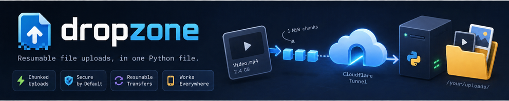

<p align="center">
  
</p>

# dropzone

A resumable file-upload server in **one Python file**, plus three static files
for the UI. No pip install, no database, no build step — drag the folder onto a
machine, run it, put a Cloudflare Tunnel in front of it, and you have a working
"send me this video" endpoint that handles files far larger than a single HTTP
request is allowed to be.

It exists because the obvious approach to "accept a big file over HTTP" breaks
in three specific ways, all of which are fixed here:

| Problem | What naive uploads do | What dropzone does |
| --- | --- | --- |
| **Proxies cap request bodies.** Cloudflare rejects any single proxied request over **100 MB** with a 413. | A 2 GB `<form>` POST fails — and only *after* the user picked the file. | Splits every file into 1 MiB chunks. Each request stays tiny, so the ceiling is never reached. |
| **A tunnel means "anyone on the internet".** | Your upload box is a public, unauthenticated write endpoint. | Refuses to start without a key unless you pass `--insecure`. Constant-time compare, HttpOnly cookie, per-IP rate limiting. |
| **Mobile links are unreliable.** One dropped packet kills the whole transfer. | The file restarts from zero, every time. | Tracks progress per chunk. Interrupted uploads resume, and a severed chunk is retried on its own. |

```
                 ┌──────────── one request per chunk ────────────┐
browser  ──► 1 MiB chunk  ──►  tunnel  ──►  dropzone  ──►  /your/uploads/
            1 MiB chunk  ──►          ──►  (join +  ──►
            1 MiB chunk  ──►          ──►   sha256)  ──►
                 └── never exceeds the proxy's body limit ──┘
```

---

## Quick start

Requires **Python 3.9+** (tested on 3.12) and nothing else.

```bash
git clone https://github.com/prathmeshnik/dropzone
cd dropzone

# 1. Start it. The key is the only thing standing between the internet
#    and your disk, so pick a real one.
python3 dropzone.py --key "$(openssl rand -hex 24)" --port 9080

# 2. Expose it. The quick tunnel URL is printed on startup.
cloudflared tunnel --url http://127.0.0.1:9080
```

Open the printed `https://…trycloudflare.com` URL, paste the key, and drop a
file in. That is the whole setup.

To try it locally first, just visit <http://127.0.0.1:9080> — it binds to
loopback by default, so nothing outside the machine can reach it.

<details>
<summary>Installing it as a command</summary>

The script is self-contained, but if you want `dropzone` on your `PATH`:

```bash
ln -s "$PWD/dropzone.py" ~/.local/bin/dropzone   # no install step, still one file
```

</details>

---

## How it works

Four steps, all visible in the page:

1. **Split.** The browser cuts the file into 1 MiB chunks and sends each as its
   own `PUT`. Because no single request is large, the proxy's body limit is
   irrelevant, and each request is short enough to finish inside the ~100 s
   timeout Cloudflare enforces.
2. **Send.** Two chunks upload at a time. Each is retried independently up to 8
   times with exponential backoff and jitter — a chunk that dies mid-body is
   re-sent, not the whole file. The server only records a chunk once the *full*
   body has arrived, so a severed attempt leaves nothing behind.
3. **Verify.** On `POST /api/finish` the server concatenates the chunks,
   checks the total against the declared size, and computes a SHA-256 of the
   result. Only then is the file moved into place.
4. **Hand back the link.** You get a URL. Because progress is tracked per
   chunk, a dropped connection, a page reload, or a backgrounded browser tab
   costs you nothing.

The one thing that makes this work on a phone: when a mobile browser
backgrounds the tab it freezes timers and stalls in-flight requests. dropzone
notices this, tells you the upload paused, and on return re-syncs with the
server to find out which chunks actually landed before continuing.

---

### Link previews

The page carries Open Graph and Twitter card metadata, so pasting the dropzone
URL into Slack, Discord, WhatsApp or iMessage renders a proper card instead of a
bare link. `web/og.png` is served at `/og.png`.

The `og:url` and `og:image` values are **derived per request** from the incoming
`Host` header and scheme, because dropzone has no configured public hostname —
it runs behind whatever tunnel you point at it, so the request itself is the
only thing that knows the right answer. Behind Cloudflare Tunnel this means the
card shows your real hostname with zero configuration.

`robots: noindex` stays set. Unfurlers fetch the page directly and ignore
`noindex`, so shared links still get a card while the endpoint stays out of
search results.

To change the card, edit `tools/make_og.py` and re-run it. Pillow is needed for
that one command and nothing else:

```bash
pip install pillow && python3 tools/make_og.py
```

---

## Usage

```
python3 dropzone.py --key SECRET [options]
```

### Layout

```
dropzone.py       the server -- all the logic, stdlib only
web/
  index.html      markup
  style.css       design system
  app.js          upload protocol, resume, retries
  og.png          Open Graph card (regenerate: python3 tools/make_og.py)
tools/make_og.py  build-time only; needs Pillow, never imported by the server
test_scripts/     test harness; testfiles/ inside it is generated, not committed
```

| Flag | Default | What it does |
| --- | --- | --- |
| `--key SECRET` | `$DZ_KEY` | Shared secret. Empty disables auth, and the server **refuses to start** unless you also pass `--insecure`. |
| `--host` | `127.0.0.1` | Bind address. Keep this on loopback behind a tunnel. |
| `--port` | `9080` | Bind port. |
| `--dir` | `./uploads` | Where finished files are written. |
| `--subdir` | *(none)* | Store inside this subdirectory of `--dir`. |
| `--serve` / `--no-serve` | serve | Allow downloads via `/d/`. |
| `--max-file-size` | `0` | Per-file cap in bytes. `0` = unlimited. |
| `--max-files` | `0` | Total cap in bytes for `--dir`. `0` = unlimited. |
| `--chunk-size` | `1 MiB` | Bytes per chunk. Clamped to 128 KiB–16 MiB. |
| `--parallel` | `2` | Concurrent chunk requests per file (max 6). |
| `--chunked` / `--no-chunked` | chunked | Resumable protocol, or a single multipart POST. |
| `--rate-limit` | `240` | Control-plane requests/min per IP. `0` = off. |
| `--rate-burst` | `60` | Control-plane burst per IP. |
| `--chunk-rate-limit` | `12× --rate-limit` | Chunk PUTs/min per IP. Kept separate so a 1 GB upload does not 429 itself. |
| `--chunk-rate-burst` | `600` | Chunk PUT burst per IP. |
| `--trust-proxy` / `--no-trust-proxy` | trust | Trust `CF-Connecting-IP` / `X-Forwarded-For` for the client IP. |
| `--hosts` | *(none)* | Comma-separated `Host` allowlist; anything else gets a 421. |
| `--insecure` | off | Acknowledge running with no key. |
| `--print-url` | *(none)* | Print this public URL in the startup banner. |

Environment variables `DZ_KEY` and `DZ_DIR` are honoured as defaults, so a key
does not have to appear in `ps` output or shell history.

### Running it as a service

```ini
# /etc/systemd/system/dropzone.service
[Unit]
Description=dropzone upload server
After=network.target

[Service]
ExecStart=/usr/bin/python3 /opt/dropzone/dropzone.py --dir /srv/dropzone
WorkingDirectory=/opt/dropzone
Environment=DZ_KEY=%E(dropzone_key)
Environment=DZ_DIR=/srv/dropzone
Restart=always
# It only ever needs to write to its own storage directory.
ProtectSystem=strict
ReadWritePaths=/srv/dropzone
PrivateTmp=true
NoNewPrivileges=true

[Install]
WantedBy=multi-user.target
```

---

## HTTP API

Everything except `/healthz` requires the key. Send it as `X-Upload-Key: …`,
`Authorization: Bearer …`, `?k=…`, or exchange it once for a cookie with
`POST /api/auth` (what the web UI does).

| Method | Path | Purpose |
| --- | --- | --- |
| `GET` | `/` | Web UI (served without a key so the prompt can render) |
| `GET` | `/style.css`, `/app.js` | UI assets |
| `GET` | `/healthz` | Liveness probe. Never authenticated — put this in your uptime check. |
| `GET` | `/api/config` | Limits and auth state, for the UI |
| `POST` | `/api/auth` | `{key}` → sets an HttpOnly cookie |
| `POST` | `/api/init` | `{name, size, chunkSize}` → `{uploadId, chunkSize, totalChunks}` |
| `PUT` | `/api/chunk/<id>/<n>` | Raw `application/octet-stream` body. The hot path. |
| `GET` | `/api/chunk/<id>` | Which chunks are still missing (used to resume) |
| `POST` | `/api/finish` | `{uploadId, size}` → verify, join, return `{name, size, sha256, url}` |
| `DELETE` | `/api/chunk/<id>` | Discard a partial upload |
| `POST` | `/api/upload` | Plain `multipart/form-data`, for scripts and small files |
| `GET` | `/api/list` | Stored files as JSON |
| `GET` | `/api/transfers` | Progress of every upload currently in flight |
| `GET` | `/api/stats` | Everything the live dashboard shows, in one response |
| `GET` | `/d/<name>` | Download, `Range`-enabled so video can seek |

Uploading from a script, no browser involved:

```bash
# Small file: the one-shot endpoint.
curl -H "X-Upload-Key: $DZ_KEY" -F "file=@notes.txt" \
     https://your-tunnel.example.com/api/upload

# Large file: init, PUT each chunk, then finish.
URL=https://your-tunnel.example.com; KEY=$DZ_KEY; FILE=big.mkv
SIZE=$(stat -c%s "$FILE"); CHUNK=$((1024*1024))

read -r ID CS N < <(curl -sS -H "X-Upload-Key: $KEY" -H 'Content-Type: application/json' \
  -d "{\"name\":\"$(basename "$FILE")\",\"size\":$SIZE,\"chunkSize\":$CHUNK}" \
  "$URL/api/init" | python3 -c 'import json,sys;d=json.load(sys.stdin);print(d["uploadId"],d["chunkSize"],d["totalChunks"])')

for i in $(seq 0 $((N-1))); do
  dd if="$FILE" bs=$CHUNK skip="$i" count=1 status=none \
    | curl -sS --fail -X PUT --data-binary @- -H "X-Upload-Key: $KEY" "$URL/api/chunk/$ID/$i"
done

curl -sS -H "X-Upload-Key: $KEY" -H 'Content-Type: application/json' \
  -d "{\"uploadId\":\"$ID\",\"size\":$SIZE}" "$URL/api/finish"
```

---

## Deployment notes

### Behind Cloudflare Tunnel

The intended setup. Bind to loopback, let the tunnel handle TLS and the
public hostname:

```bash
python3 dropzone.py --key "$DZ_KEY" --port 9080
cloudflared tunnel --url http://127.0.0.1:9080
```

### The two limits that actually bite

Cloudflare imposes **both** of these, and the second is the one that surprises
people:

- **100 MB** maximum request body. Never hit it — that is the point of chunking.
- **~100 s** maximum request duration, *including* the time your origin spends
  reading the body. This is why the default chunk is a conservative **1 MiB**
  and parallelism is **2**. Bigger chunks multiplied by parallel lanes push
  requests past the timeout on a high-latency or mobile link, and Cloudflare
  cancels them mid-body. If you raise `--chunk-size`, lower `--parallel`.

On a link with no proxy in front, raising both is fine:

```bash
python3 dropzone.py --key "$DZ_KEY" --chunk-size $((8*1024*1024)) --parallel 4
```

### Without a tunnel

Any reverse proxy works (nginx, Caddy, Traefik). Terminate TLS there, forward
to `127.0.0.1:9080`, and pass `X-Forwarded-For` — with `--no-trust-proxy` off,
that header is what per-IP rate limiting keys on.

---

## Security

The honest version, including what this is **not**:

- **One shared key, no accounts.** Anyone holding the key can upload, list, and
  download **every** stored file. There is no per-user isolation and no way to
  make one. Treat the key as the only perimeter, and give it out to exactly
  who should see the whole folder. If you need real per-user isolation, you
  need a different tool.
- **No scanning, no allow-list.** Filenames are sanitised and path traversal is
  blocked, but **content is not inspected**. Anyone with the key can upload
  anything, including files that are large enough to fill your disk.
- **Uploads are served from your origin.** Downloads are forced to
  `Content-Disposition: attachment` unless the type is an image, video, audio
  or PDF, and `X-Content-Type-Options: nosniff` is always set, so an uploaded
  `.html` or `.svg` cannot execute on your origin. Do not relax this by
  serving the storage directory directly from nginx.
- **Stored XSS is contained, not solved.** Treat the storage directory as
  untrusted input anyway.
- **Rate limiting is per-IP, in memory.** It resets when the process restarts
  and does not survive a second instance. Do not run two instances against one
  key and expect the limit to be shared.
- **The dashboard is not an audit log.** `/api/stats` reports what is in flight
  right now, and deliberately omits the client IP, because that endpoint sits
  behind the shared key and the key is often held by more than one person. For
  who uploaded what, read the server log.
- **Everyone sees the same page.** There is one URL and no per-user accounts,
  so "the operator" and "somebody who was sent the link" are the same view.
  The page separates them by what each browser is *driving*: your own uploads
  appear in the queue with pause/cancel/copy controls, and anyone else's appear
  in the Incoming section as read-only rows. That is a UI convenience, **not a
  permission boundary** — anyone holding the key can already list and download
  every stored file.
- **Storage accounting is a directory walk**, recomputed at most once per
  second and shared between pollers. It is accurate, not cheap: fine for
  thousands of files, slow for hundreds of thousands. That walk is also what
  `--max-files` is checked against, so a huge directory slows every request.
- **TLS is somebody else's job.** The server speaks plain HTTP. Without a
  tunnel or a reverse proxy in front, the key crosses the network in clear
  text.
- `--trust-proxy` defaults to on because the origin is meant to be unreachable
  directly. **If you expose the port publicly, pass `--no-trust-proxy`** or
  anyone can spoof their IP past the rate limit.

---

## Known limitations

Honest list of what this does not do:

- **In-memory session state.** Chunk sessions live in a `dict` in RAM. Restarting
  the process abandons every in-flight upload (already-finished files are
  untouched, and the client detects this and restarts the file). Don't run two
  instances against one `--dir`: a chunk written by instance A is invisible to
  instance B.
- **No horizontal scale.** One process, one disk, one box. There is no shared
  state and no sticky-session logic, so this is a single-node tool by design.
- **Quota accounting is a directory walk.** `--max-files` re-walks the storage
  directory to measure usage. That is fine for thousands of files and
  genuinely slow for hundreds of thousands. It is also why `--max-files`
  is 0 (off) by default.
- **No expiry, no retention policy.** Files stay until you delete them. Partial
  uploads are reaped after 6 hours idle; finished files never are.
- **No virus scanning, no thumbnails, no dedup, no versioning.** The SHA-256 is
  computed to *report* integrity, not to deduplicate.
- **Backgrounded mobile tabs can still stall.** The page warns you and
  re-syncs on return, but a browser that freezes JS indefinitely cannot be
  helped from the other side. Come back to the tab.
- **Not hardened as a general-purpose public file host.** See
  [Security](#security). If you need quotas per user, moderation, or an audit
  trail, use a real object store.
- **Python 3.9+ only.** No 3.8, no PyPy promises.
- **`Content-Length` is trusted** for chunk bodies, since chunked transfer
  encoding is not supported on the `PUT /api/chunk/…` path.

---

## Contributing

The whole thing is one file on purpose — it is meant to be readable, copyable,
and auditable in a single sitting. A few conventions the code follows:

- **Stdlib only.** No dependencies, ever. That is the feature.
- **Comments explain *why*.** The interesting parts of this codebase are all
  workarounds for something subtle (Cloudflare's timeout, pooled keep-alive
  connections, mobile backgrounding). Keep that reasoning attached to the code.
- **The UI is three static files, no bundler.** `web/index.html`,
  `web/style.css` and `web/app.js` sit next to the server. Edit one, reload
  the page. `index.html` gets `__CONFIG__` substituted per request (that blob
  carries this deployment's limits and auth state); the other two are served
  as-is and are safe to cache. Only those three names are ever served, so
  there is no user-controlled path to sanitise.
- **The upload protocol is load-bearing.** Chunked upload with per-chunk retry
  and resume is the entire point of this project, so changes to `app.js`,
  `handle_chunk()`, `assemble()` or the session store should be treated as
  correctness changes rather than refactors. In particular: `storage._lock` and
  `Session.lock` are plain `Lock`s, not `RLock`s — calling a method that takes
  the same lock from inside a `with` block will deadlock the request thread.
  There are three regression tests around that in the harness.

---

## Testing

The harness lives in `test_scripts/`. It exercises the real HTTP surface and
the real client JavaScript — there are no mocks of the code under test.

```bash
# 159 assertions over the whole API: auth, quotas, chunking, resume,
# keep-alive, traversal, filename handling, the served page, OG metadata.
python3 test_scripts/test_dropzone.py

# End-to-end upload of ~130 MiB of awkward files (unicode names, spaces,
# double extensions) through a proxy that deliberately severs 1 chunk in 3
# mid-body. Every file must still arrive byte-identical.
python3 test_scripts/test_reality.py
```

`test_reality.py` starts its own throwaway server and storage directory, so
neither script needs anything running first. It needs `node` on `PATH` for the
client harness, and it regenerates its fixtures on demand rather than
committing ~130 MiB of random data. Point it at a live server instead with:

```bash
python3 test_scripts/test_reality.py https://your-tunnel.example.com "$DZ_KEY"
```

The reality suite is the one that matters: a truncated chunk used to kill the
whole upload, and it is the only thing that proves it no longer does.

---

## License

[MIT](LICENSE). Use it, self-host it, sell hosting on top of it.